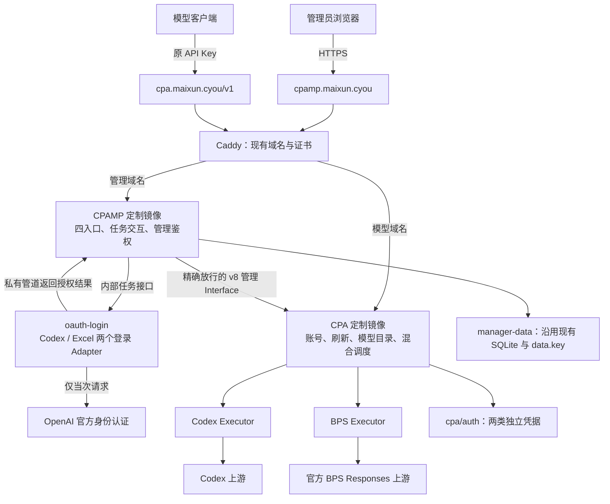

# CPA 四入口登录与 BPS 通道方案

日期：2026-11-10（北京时间）  
状态：本地候选实现、Linux 构建、三容器集成与独立审查已通过；真实登录、模型调用、生产部署尚未执行。实际接口以 `docs/contracts/` 为准，验证状态见 `docs/local-candidate.zh-CN.md` 与组件回执。

独立设计审查：未发现新增结构性问题。BPS 手工 OAuth 的回调兑换仍是前置可行性待证，不属于已通过项。

## 1. 已确认的产品行为

| 入口 | 授权方式 | 取得的授权 | 固定执行通道 |
|---|---|---|---|
| Codex OAuth | 保留现有官方页面授权 | Codex | Codex |
| Codex 2FA | 邮箱、密码、TOTP 种子 | 仅 Codex | Codex |
| BPS OAuth | 官方 Excel 页面授权 | 仅 Excel/BPS | BPS |
| BPS 2FA | 邮箱、密码、TOTP 种子 | 仅 Excel/BPS | BPS |

- 每次登录只申请所选通道的一份授权，不顺带取得另一份授权。
- 同名模型对客户端合并展示，系统自动选择可用账号；选中账号后，其执行通道固定。
- 不把 Excel token 导入为 Codex token，也不以修改 `client_id` 的方式转换授权。
- 登录器在本台 OVH VPS 内部运行，不连接第三方重登服务。
- 密码、TOTP 种子仅当次使用，不长期保存。需要持久化的 access/refresh token 与密码区别处理。
- 自动化范围是令牌刷新；refresh token 失效后提示用户重新登录，不实施无人值守密码重登。
- 保留现有域名、Base URL、API Key 和其他平台入口。

## 2. 选定架构

采用“两份定制镜像 + 一个内部登录执行容器”，复用 CPA 的账号存储、调度与用量链路，不再增加模型网关或独立账号数据库。

### 2.1 Module、Interface 与写入责任

| Module | 对外 Interface | 负责 | 不负责 |
|---|---|---|---|
| CPAMP 登录编排 | 创建、查询、取消登录任务；提交 OAuth 回调 | 管理鉴权、四入口、状态反馈、协调账号导入 | 模型转发、长期保存密码、刷新 token |
| 登录执行 Module | `Login(profile, credentials)` | 单次 Codex/Excel 密码与 TOTP 登录；取消、超时、清理 | 账号文件写入、账号调度、自动重登 |
| CPA 授权 Module | v8 OAuth、凭据导入、既有凭据管理 | PKCE/state、手工 OAuth 交换、凭据校验与保存、刷新 | 保存密码/TOTP、前端任务展示 |
| CPA BPS Executor | 与现有 Executor 相同的 Interface | BPS 请求、流式响应、错误与用量归一 | 伪装 Codex token、独立账号池 |
| CPA 模型目录与调度 | 现有模型注册、选账号、pin/affinity Interface | 同名模型去重、可用账号选择、会话固定 | 再建一份调度数据库 |

两个真实变化点形成内部 seam：登录执行使用 Codex/Excel 两个 Adapter；推理执行使用 Codex/BPS 两个 Executor。除此之外不增加通用插件框架或第二套控制面。

### 2.2 为什么选择这套结构

- BPS 是独立授权和推理协议，放进 CPA 才能复用现有模型调度、用量与账号生命周期。
- Python/Node 登录依赖放在内部容器，不塞进每次模型请求的执行路径，也不扩大 CPA 主镜像的运行依赖。
- 不在 Caddy 前面增加“BPS 专用网关”：否则会重复实现鉴权、调度、模型目录和用量汇总。
- CPAMP 保持管理角色；CPA 是推理凭据的唯一落盘者和刷新者。

## 3. 两类登录流程

### 3.1 Codex 2FA / BPS 2FA

1. 管理员在对应入口输入邮箱、密码、TOTP 种子；前端不写 localStorage/sessionStorage。
2. CPAMP 验证管理员会话，创建内存任务，固定本次 `profile=codex` 或 `profile=excel`。
3. 内部登录执行容器启动隔离任务，通过 stdin 或专用文件描述符传递输入，不使用 argv/env/明文输入文件承载密码、TOTP。
4. 对应 Adapter 执行官方身份认证，只完成所选 profile 的授权。
5. 授权结果通过私有进程管道返回；不继承到容器 stdout/stderr 日志，不返给浏览器。
6. CPAMP 通过受控的 CPA v8 导入 Interface 提交结果；沿用账号写入协调与冲突检查，不挂载 CPA auth 目录自行写文件。
7. CPA 保存并注册账号后，任务才标为成功。浏览器只收到账号标识、通道、有效期、结果说明。
8. 完成、失败、取消或超时后清除凭据引用与子进程；不保留用于下次密码重登的材料。

任务状态：`created → running → importing → succeeded`；错误、取消、超时分别进入 `failed / cancelled / expired`。官方要求额外验证时返回 `needs_user_action`，提示用户处理，不无限重试。

个人自用首期设置为一个进行中的 2FA 任务，忙时明确返回，不添加 Redis 或磁盘任务队列。登录任务最长 25 分钟，终态只短时保留脱敏结果；Manager/Worker 重启后未完成任务作废，用户重新发起。

### 3.2 Codex OAuth / BPS OAuth

- Codex OAuth 保留现有入口和行为。
- BPS OAuth 由 CPA 建立独立 Excel PKCE 会话，使用 Excel 的官方 client 和回调地址。
- 用户在官方页面完成授权，再在管理页提交完整回调 URL；服务端校验会话归属、state、有效期与 PKCE 后交换授权码。
- 官方回调仍在 `bps.openai.com`，不擅自改为用户域名，不要求给 VPS 额外开放 localhost 回调端口。
- 用户未完成回调、取消或会话过期时不导入账号。回调 URL/授权码不进入访问日志或错误详情。

手工 BPS OAuth 有一项前置待证：浏览器到达官方回调页后，授权码可能先被官方页面消费。现有静态证据尚未证明“页面加载后复制 URL”总能兑换。P0 必须先验证可复现的回调提交流程，并取得真实可兑换回执；静态或假上游测试只证明契约，不替代该项。真实授权由用户操作并另行确认，本轮不执行。若出现已消费授权码，不循环兑换，也不把改用 BPS 2FA 当作该入口已经完成。此项未通过前不宣布四入口全部可用。

## 4. 最小管理 Interface

已实现的管理编排与组件契约分别见 `docs/contracts/login-worker.md`、`docs/contracts/cpa-login-v8.md`。

| 调用方 → 被调用方 | Interface | 输入/输出约束 |
|---|---|---|
| 浏览器 → CPAMP | `POST /api/oauth-login/tasks` | 2FA 输入 `profile/email/password/totp_secret`；仅返回 task id 和状态 |
| 浏览器 → CPAMP | `GET /api/oauth-login/tasks/{id}` | 仅返回状态、脱敏错误、账号标识，不返回 token/密码/TOTP |
| 浏览器 → CPAMP | `DELETE /api/oauth-login/tasks/{id}` | 取消任务；已提交导入时以真实导入结果为准，不宣称账号已经撤回 |
| CPAMP → Worker | 创建/查询/取消内部任务 | 内部共享密钥鉴权，不向公网映射；结果仅后端可读 |
| CPAMP → CPA | 现有 v8 OAuth auth-url/status/callback/import/session | 按所选 profile 严格校验，显式允许的路径和方法，不开放整个 v8 子树 |

- 新能力只扩展 v8，不向已弃用的 `/v0/management` 添加功能。现有 Codex v0 调用保持兼容，不为此次改造重写。
- CPAMP 当前只允许有限 v8 只读代理；新增 OAuth/导入路由必须接入现有账号写入协调，不能只加一个宽泛转发规则。
- 密码与 token 不进入 URL、日志、任务错误堆栈、浏览器缓存或调试导出。
- 任务输入与结果不进入 CPAMP SQLite。登录编排不持有 CPA auth 目录写权限。

## 5. 凭据、刷新与数据

### 5.1 两种凭据契约

- Codex：保留现有 `type=codex` 与现有文件格式，刷新使用 Codex client。
- BPS：新增独立 `type=bps`；记录 Excel profile、对应 client、账号身份、token、过期和最后刷新时间。
- BPS 文件与 Codex 文件独立命名，以通道和官方账号身份区分；同邮箱的两份授权不互相覆盖。
- 不以邮箱相同证明两个授权属于同一官方账号，不用解析 JWT 字段代替真实授权交换成功。
- 新登录完成后先校验通道、client 与必需字段，再做原子写入和热注册。刷新不能把 BPS token 写进 Codex 文件。
- BPS 刷新按供体 Excel 契约使用 `/oauth/token?unified=true` 与 Excel client，不复用普通 Codex 刷新请求。
- 供体 `openai_bps_credentials.go` 的现有规范化会删除 `refresh_token`，这段行为不移植；BPS 必须保存刷新所需 token。Codex 保持其原必需字段，BPS 的 ID token 完成身份核对后不要求持久保存。

### 5.2 唯一刷新责任

CPA 是唯一刷新者；CPAMP、Worker 不另开刷新定时任务。

- 有效 refresh token：沿所属 client 自动续期，保存最新轮换结果。
- 暂时网络故障/限流：保留凭据，按既有退避策略处理。
- 明确授权失效：该账号退出可用调度，面板显示需补登录；不删除账号，不尝试另一 client。
- 同账号同时出现刷新与补登录时，写入必须经过同一凭据协调机制，旧刷新结果不得覆盖新授权。

### 5.3 存储变化

| 数据 | 处理 |
|---|---|
| CPA 现有账号文件 | 原位保留；新增 BPS 独立凭据文件 |
| CPA `kv.db` | 保留，仍为 bbolt；不当作 SQLite，不手工清库 |
| CPAMP `usage.sqlite`、WAL/SHM、`data.key`、历史归档 | 原位保留，不导入 Sub2API 数据库 |
| 密码、TOTP 种子 | 仅当次内存与私有进程管道，不长期保存 |
| 各通道必需 token | 仍需持久化至 CPA 凭据存储；不是“所有凭据都不落盘” |

本设计不新增 SQL 表或 schema 迁移。将来真实登录会新增/更新账号凭据；模型调用会产生正常用量数据，均属于运行时写入。CPA auth 文件沿用现有 secret 文件保护方式，不把它描述为整个目录已经加密。

## 6. 同名模型与请求执行

### 6.1 模型名合并，授权不合并

同一公开模型名可以注册到 `codex`、`bps` 两个 provider；`/v1/models` 对外去重，内部保留 provider 与账号对应关系。

例如同名模型有两个 Codex 账号、一个 BPS 账号，在同优先级、都可用且无会话绑定时，沿用 CPA mixed 调度的账号槽位轮询，约按 2:1 使用账号，不强制 Codex/BPS 通道各占一半。账号优先级、冷却和已有配置仍有效。

BPS 只注册已确认支持的模型，不复制供体旧默认列表作为当前官方模型能力证明。首期使用明确配置的 BPS 模型清单；没有可靠模型来源时不宣称自动发现。

### 6.2 首期协议范围

- 已实现现有 `/v1/responses` 与 `/v1/chat/completions` 的 BPS 文本请求及 SSE，本地合成输入与真实业务验收分别记录。
- BPS Executor 处理专用地址、官方账号头、请求转换、错误归一、响应/SSE 转换和真实用量上报。
- 保留现有“业务转换完成 → 应用用户 payload 规则 → 只做传输封装”的顺序，不在后续阶段覆盖用户配置。
- BPS 不冒充支持 Codex WebSocket、服务端 `previous_response_id` 续聊或其他尚未实现的路径。请求选择前过滤不匹配的能力。

### 6.3 会话、重试和输出

- 普通无状态请求可以按可用账号混合选择；有既有会话约束时，复用 CPA pin/affinity Interface 固定原 provider 与账号。
- 供体 BPS 明确要求完整历史，不支持 `previous_response_id`。涉及加密 reasoning、compaction、工具回放等账号相关上下文时，必须证明原通道与账号绑定；绑定缺失则明确提示重新建立上下文，不随机发往另一账号或 Codex。
- 不假定当前部署已启用严格 session-affinity；实施时核现有配置，仅为这次新增路径接入必要绑定，不擅自改变全局策略。
- BPS 多轮工具/映射状态只有在严格绑定有效时开放；绑定丢失、过期或不明确时提示新建会话。不增加持久 response 路由框架。
- BPS 在 WS 选账号之前排除，也从 WS passthrough 的候选 provider 检查中排除，防止新增同名 BPS 模型破坏原有 Codex WS 路径。
- 重试仅限既有策略允许、且尚未向客户端输出、可重放的失败；鉴权、参数或明确不兼容错误不做盲目跨通道重试。
- 首段输出后不跨账号拼接重试；断流返回真实错误，避免重复输出和重复执行工具。
- 所有失败只影响相应账号/通道；不因 BPS 故障禁用正常 Codex 账号。

## 7. 管理面板与用量

- OAuth 区提供四个清楚命名的入口，现有其他平台不变。
- 账号列表明确标注 `Codex` / `BPS`、登录来源、刷新状态与需补登录状态，不显示为 unknown 或伪装成 Codex。
- 同名模型汇总可保留；明细至少可按 provider、账号、请求结果区分，便于定位走了哪个通道。
- BPS 不套用 Codex 的巡检、额度查询、自动禁用或删除逻辑；未支持的指标标为未提供，不填假数值。
- 继续使用 HTTP 用量采集；BPS Executor 接入 CPA 原生用量上报，不建立另一套计费库。
- 巡检、定时模型测试、自动账号动作仍保持关闭；不通过此改造重新开启。

## 8. 部署形态与改动面

### 8.1 容器与网络

| 容器 | 变化 | 对外端口 |
|---|---|---|
| Caddy | 域名、现有模型/管理入口保留 | 仍只有 80/443 |
| CPA | 切换为带 BPS 能力的定制镜像 | 仍仅内部 8317 |
| CPAMP | 切换为四入口与任务编排定制镜像 | 仍仅内部 18317 |
| oauth-login | 新增单任务登录执行容器 | 只在 Compose 网络，不映射宿主机端口 |

登录容器不挂载 Docker socket、CPA auth 或 Manager 数据卷；只挂载内部通信所需 secret，临时工作目录用任务级 tmpfs。密码/TOTP 仍走管道，不以 tmpfs 文件替代输入隔离。VPS 的 SSH、防火墙、时区、代理与 OVH 设置不变；不把 Windows 的 7890 代理写到服务器。

### 8.2 主要代码位置

- CPAMP：`apps/web/src/features/oauth`、账号类型/标签、前端登录任务 Interface；Manager 新增内存任务编排与明确的 v8 代理/导入协调。
- CPA：新增 BPS auth 与刷新 Adapter、BPS Executor 与必要协议转换，接入现有模型注册/账号加载、v8 OAuth/import、用量上报。
- 登录容器：提取供体单 profile 登录核心、Codex/Excel Adapter 和所需 Node/Python 依赖；去掉与 Sub2API 数据库、旧任务、托管重登和磁盘凭据流的耦合。
- 发布材料：Compose 内部登录 Module、定制镜像构建与版本标识、验收和定向回退说明。

## 9. 实施顺序与验收

本轮按两条独立实施线交付：CPA 运行时；CPAMP 与登录容器。CPA v8 契约由运行时线单写，管理线按契约接入；主会话整合并组织独立审查。同输入验证复用，新增修复只补受影响项。

| 阶段 | 交付 | 进入下一阶段的依据 |
|---|---|---|
| P0 固定输入与可行性 | 独立目标工作树、所选供体文件与真实 diff、Interface 契约；验证 BPS 手工回调流程 | 不带入未知改动；来源可追溯；BPS 手工 OAuth 须有真实可兑换回执，未获授权则保留待证，不以假上游代替 |
| P1 核心验证 | BPS 执行与刷新专项、双 profile 登录 Adapter、假上游测试 | 通道/client 严格隔离；无凭据泄露；可编译 |
| P2 本地整合 | 四入口、导入状态、模型合并、用量、取消与刷新竞态 | 两条线通过共同 Interface，普通 Codex/其他平台无回归 |
| P3 本地交付 | 三份定制镜像、最小 Compose 变更、专项记录和回退材料 | 构建一次；同输入证据复用；实际 Linux 容器集成通过 |
| P4 另行批准上线 | 只读现场预检、本次必要备份、受控切换 | 发布前核实际镜像/挂载/数据与当前运行状态；未经确认不操作 |
| P5 用户业务验收 | 四入口实测、分别刷新、逐通道模型与 SSE 请求 | 绑定真实环境和结果；登录成功、导入成功、模型成功分别记录 |

### 必测失败

1. BPS token 被当 Codex 导入、错误 client 刷新：拒绝且不修改另一通道。
2. 登录取消/超时/进程退出/Manager 重启：不残留长期密码或 TOTP，不把未导入标成功。
3. 重复提交、补登录与自动刷新冲突：不重复覆盖账号，不以旧结果覆盖新授权。
4. Manager v8 路由放行：只允许列明的路径/方法，保留既有管理员鉴权和账号写入协调。
5. 同模型多 provider、冷却与绑定：账号走固定 Executor；缺会话绑定不随机回放；无状态请求按现有策略调度。
6. SSE 中途断流、工具输出后失败：不拼接另一账号的输出，不重复执行已输出的调用。
7. 原 Codex OAuth/刷新、既有 auth 文件与其他平台：原功能回归通过。
8. BPS 用量与错误：只写真实可提取值，不把未知用量或额度记为成功的零值。

本地测试使用假凭据和假上游；不触发收费模型或真实登录。真实验证由用户在界面输入凭据后单独安排，凭据不贴聊天。缺少真实验收时只标本地候选完成。

## 10. 回退与已知限制

- 现有日备份方案仍暂不采用，不安装自动备份或每日停机任务。未来上线前需要的本次升级备份单独列入发布方案，经确认再执行。
- 保留原 CPA/CPAMP 镜像和 Compose；回退停新增登录容器，恢复原入口与运行时。不整库回灌，不回写已经轮换失效的旧 refresh token。
- 新 BPS 凭据保留；回到不识别 BPS 的原镜像时，从活动加载目录隔离新增 BPS 文件，不删除它们，也不影响普通 Codex 凭据。具体目录动作在发布前核清。
- 供体存在历史真实 BPS 登录/刷新记录，不代表当前 OpenAI 流程、当前 CPA 改造或本台 VPS 已通过；额外验证、授权变更和模型可用性仍需实测。
- 登录依赖已由独立锁文件与容器构建固定，运行需同时配置内部 Worker 与共享 secret。
- 首期不承诺 BPS 原生 WebSocket、服务端响应 ID 续聊、图片/音频或完整工具协议；未纳入测试的能力不注册为 BPS 可处理。
- 保留供体及依赖的来源、许可文件和必要声明，不将复制来的文件统一覆盖成目标项目许可。

## 附录：已核源码基线

| 对象 | 位置 | 基线 |
|---|---|---|
| CPA | `components/cpa` | v8.0.63，`6db7d4b839d86c5b24e17bbe73bcd4db18ef1b1a` |
| CPAMP | `components/cpamp` | v1.14.10，`a67ed8834a914ab24c36d2490fa6bb6d4166724c` |
| 图示功能供体 | 本地独立供体工作树，不整包入仓 | HEAD `c46cd611d2391f68d51a6bc08c34ab1f8b16ceaf`；有未提交修改，HEAD 不是全部输入 |
| 登录依赖 | `components/oauth-login`，来源详见组件 NOTICE | `8548397e89bf80e508eda64a87e0d556d43abc84` |

供体只读，不接续旧 R02/task4，不改旧任务、账号、日志与未提交改动。实施前只提取本次需要的文件和相应真实改动，不把旧工作区整包复制到新项目。

### 关键源码依据

- CPAMP `apps/web/src/features/oauth/OAuthPage.tsx`、`apps/web/src/services/api/oauth.ts`：当前 OAuth 界面与调用。
- CPAMP `apps/manager-server/internal/service/proxy/service.go:84-89`：当前 v8 代理限制；新增能力需要显式接入。
- CPA `internal/api/server_management_v8.go:54-61`：既有 v8 OAuth/import/status/session 路由。
- CPA `internal/auth/codex/openai_auth.go:25-28,229-237`：普通 Codex client 与刷新，不通用处理 Excel token。
- 供体 `backend/internal/pkg/openai/oauth.go:18-38`：Codex、Excel 两套 client/回调。
- 供体 `tools/openai_excel_2fa_login.py:29-45`、`tools/openai_excel_oauth_adapter.py:25-35`：独立 Excel 2FA 路径。
- 供体 `tools/openai_oauth_reauth_worker.py:1504-1514,1569-1571,1668-1673`：现有 argv/env/文件路径需拆除后才符合本方案的凭据输入要求。
- 供体 `backend/internal/service/openai_bps_credentials.go:13-18`：专用 BPS Responses 地址与授权可用性说明。
- 供体 `backend/internal/service/openai_bps_protocol.go:143-151`：BPS 完整历史要求，不支持 previous_response_id。
- CPA `sdk/cliproxy/service_executors.go:261`、`sdk/cliproxy/service_models.go:32`：Executor 与模型接入点。
- CPA `sdk/cliproxy/auth/scheduler.go:477,614-664`：mixed 候选与按账号槽位轮询。
- CPA `sdk/cliproxy/auth/conductor_refresh.go:1231`：既有刷新锁与凭据版本协调。
- CPA `sdk/api/handlers/handlers_context.go:73,85`、`sdk/cliproxy/auth/conductor_selection.go:769`：pin、已选账号回调与会话归属查询。
- 供体 `tools/openai_excel_oauth_adapter.py:61-62`、`backend/internal/service/openai_bps_credentials.go:63`：BPS token endpoint 与不应照搬的 refresh token 删除行为。
