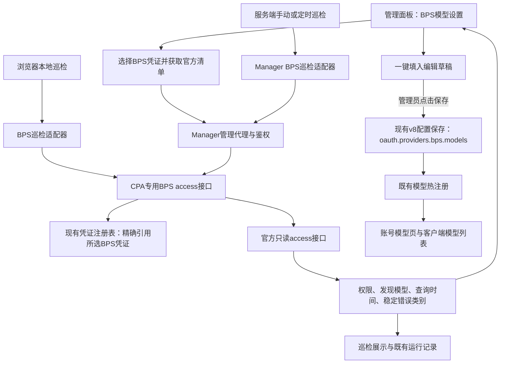

# BPS 模型配置与巡检修复方案

日期：2026-11-11（北京时间）。项目：MX-CPAMP。源码基线：`ad27014c8d3301ea51ccb918929aaa1666b556bb`，分支`codex/openai-bps-login`。状态：Q1—Q5产品决定已确认，修复方案已完成独立只读审阅；待用户确认整体方案后实施。当前仅整理方案，未修改产品代码或执行真实请求。

## 1. 问题与目标

本轮[手工BPS OAuth](evidence/bps-callback-scope-20261111/MANUAL-RESULT.zh-CN.md)已完成真实唯一保存注册，固定候选与归属清理均通过。现有两个问题分别修复：

| 问题 | 已核原因 | 修复后的行为 |
|---|---|---|
| 账号模型数0 | 临时配置没有`oauth.providers.bps.models`；BPS注册只读取该显式清单，现有BPS卡片仅管理协议和图片开关 | 提供模型发现、人工确认发布入口；空状态指向BPS模型设置，并区分登录、发现、发布 |
| 巡检集合0 | 日志已读到1份文件，但目标仅codex；界面、后端白名单和探针目前只接Codex/xAI | BPS可单选或与其他通道混选，进入独立BPS探针，日志显示真实筛选和探测数 |

已通过的OAuth回调、令牌保存注册、既有BPS推理/工具/图片专项按输入等价复用；不重新实现登录或令牌刷新。

## 2. 已确认的产品行为

| 决定 | 用户确认 |
|---|---|
| 修复范围 | 模型清单配置、空状态提示、BPS巡检一起修复 |
| BPS巡检动作 | 首版只检测、展示和记录；不自动删除、启用、禁用凭证 |
| 默认探测 | 官方只读权限/模型目录查询，不发推理请求；刷新沿用现有机制，巡检不额外强制刷新 |
| 状态表达 | 权限查询成功与真实推理成功分别展示；没有可靠来源的额度显示未知 |
| 模型发布 | 自动发现官方允许模型，管理员人工确认发布；一键选用只填入编辑草稿，保存后生效 |
| 模型配置归属 | 一份BPS全局发布清单，各凭证独立显示发现结果，保留逐凭证禁用规则 |

查询超时、限流、上游错误或坏响应时，显示本次失败/未知，保留已发布配置及凭证。已有页面发现结果若继续展示，必须携带查询时间与未更新标识；失败不伪造空目录或零额度。完整模型目录仅保留在页面内存，巡检历史记录权限观察、状态码、查询时间及稳定错误类别，不新增发现目录的持久化缓存。官方目录由巡检和设置页的获取操作自动解析，不另建后台轮询任务。

## 3. 事实依据与供体复用

实际供体仓库为`D:/sub2api/sub2api-custom`，固定提交`0ef3ce8fe2db1193eeb4cd93f9db9301b4252982`已核为commit。供体文件`backend/internal/service/openai_excel_bps_model_access.go`已有以下无推理请求契约：

```http
GET https://bps.openai.com/basispoints/api/responses/access?include_models=true
Accept: application/json
```

其解析`allowed`、`model_catalog.models`、`restricted_models`，以及模型available/enabled/model_picker_enabled/policy状态。该契约支持查询访问权限和可发现目录，不能单独证明模型推理成功、剩余额度或套餐到期。

只移植低层请求和解析契约。供体高层`FetchExcelBPSModelsList`会经token获取函数刷新、写回grant，某些失败分支还会删除凭据，不适合作为本次只读巡检的直接调用入口。供体工具探针实际会发多次推理请求，也不纳入默认巡检。

MX现有BPS executor的通用`HttpRequest`仅允许推理URL，因此新增专用只读管理接口；保持推理通道原地址约束。该上游access接口当前在线表现尚未实测，属于实施后的定向真实验收项。

## 4. 架构



### CPA：唯一的上游凭证使用者

新增管理接口的候选形式为`GET /v8/management/bps/credentials/access?auth_index=...`，实施时冻结精确路由与字段契约。它只接受现有凭证引用，要求管理鉴权和BPS类型；使用所选凭证的现有access token及出口配置，只请求固定官方host/path。浏览器与Manager均不接收token。

接口不刷新、不补登录、不修改凭证或模型配置，不跨账号fallback，不改变推理executor。返回经过字段白名单归一的数据，包含权限状态、过滤后的模型ID、查询时间和稳定错误类别；不返回原始令牌、完整上游错误正文或任意URL代理能力。该专用只读管理GET使用5秒探测预算并支持上层取消。CPA当前网络约定只豁免既有管理APICall超时，因此实施时同步在`components/cpa/AGENTS.md`明确这一专用access探针的有限超时例外；例外只作用于本接口，推理、流式、图片与工具续轮保持原约定。

### Manager与Web：共用探测契约，分别接入现有巡检入口

服务端及浏览器本地巡检均增加明确BPS分支，统一消费CPA归一结果；不再让未知provider落入Codex探针。目标类型使用可组合的多选，支持Codex、xAI、BPS及其组合；已有配置保留原选择，升级后不自动改变原巡检集合。

BPS结果始终采用只读动作，且`autoRecoverEligible=false`；不进入Codex专有的401/402删除、禁用或恢复判断。其他通道的既有策略继续生效。零匹配日志应展示读取总数、目标类型和过滤数量，避免把未选中误读成凭证未加载。

### 模型设置：发现与发布分开

复用系统设置中的BPS区域，新增模型设置入口：选择一份BPS凭证、获取官方清单、查看结果与查询时间、一键填入草稿、人工编辑并保存。现有协议与图片设置保持各自的保存职责。

已发布模型继续由`oauth.providers.bps.models`存储。通过现有v8配置读改写路径保存，仅修改该字段，保留其他配置。保存影响当前CPA实例全部BPS凭证的可注册目录，各凭证已有模型禁用规则继续生效；发现结果本身不自动改变模型池或调度。

账号详情页至少区分：已登录但尚未发布BPS模型、已发布模型被现有规则过滤、权限查询受限、查询尚未完成/失败。提供指向BPS模型设置或相应规则的入口，不再统一提示去普通AI提供商绑定。分别展示全局发布数、本凭证官方允许数和逐凭证禁用规则过滤后的注册数。

全局已发布、但本凭证官方未允许的模型标为“权限不匹配”，不显示为当前凭证可调用；缺少有效查询结果时标为权限未确认。管理员可沿用已有逐凭证禁用规则限制其调度。本轮巡检不自动写这些规则或修改调度候选，官方允许、本站已注册和真实推理成功分别表达。

## 5. 巡检结果语义

| 观察 | 展示 | 自动动作 |
|---|---|---|
| HTTP200、结构有效、allowed=true | BPS访问权限查询通过，展示发现模型 | 仅记录 |
| HTTP200、allowed=false | 当前BPS访问权限受限，模型查询结果按返回表达 | 仅记录 |
| 有效响应但允许模型为空 | 已查到0个允许模型，区分未发布模型 | 仅记录 |
| HTTP401 | 本次凭证认证未通过，等待既有刷新机制或人工处理 | 仅记录，不强制刷新/补登录 |
| HTTP403 | 本次访问被拒绝，不据此推断封号、套餐失效或令牌无效 | 仅记录 |
| HTTP429 | 本次查询受限流影响，状态待后续巡检确认 | 仅记录 |
| 超时、5xx、结构缺失/坏响应 | 本次查询失败或状态未知 | 仅记录，保留发布配置 |
| 仅有本地token及到期字段 | 仅表示本地凭证信息 | 不写成上游健康通过 |

额度值保留null并显示未知，不伪造0%或100%；token到期时间明确标为令牌到期，不显示成账号/套餐到期。真实推理状态仅引用该实例可核实的既有推理记录，没有记录则显示未验证；access查询不更新推理成功时间。

## 6. 实施拆分

采用两条实施线与一个独立只读审查席，共享文件单写：

| 线 | 负责 | 主要文件域 |
|---|---|---|
| A：CPA access探针 | 固定地址只读请求、字段解析、精确凭证引用、管理路由与归一契约 | `components/cpa/internal/auth/bps/`、management handler及v8路由、对应专项 |
| B：Manager/Web | BFF、两端巡检BPS分支、目标多选、结果策略、模型设置与空状态 | `components/cpamp/apps/manager-server/`与`apps/web/src/`，同一负责人协调契约 |
| 主会话 | 冻结接口、整合证据与当前态、统一构建和交付 | 总体文档与整合分支 |

先冻结A线归一契约，再并行实现A/B。Worker输入不变，复用既有产物；只为实际改动的CPA和Manager各做一次最终构建，不重复构建相同输入。

## 7. 最小充分验收

1. **类型与路由：** 唯一BPS凭证被选中时集合为1；BPS单选/混选在浏览器及服务端均进入BPS分支，零Codex usage请求；旧目标配置往返不变。
2. **真正只读：** 合成上游记录仅收到预期access GET；token刷新、登录、推理、凭证删除、启用/禁用和配置写入次数均为0。精确凭证/实例漂移和非BPS引用被明确拒绝，不fallback。
3. **响应与动作：** 覆盖allowed真/假、空模型、restricted/disabled模型、401/403/429/5xx、坏结构、取消；未知额度保持null、所有BPS自动动作保持只读，既有Codex/xAI受影响专项按输入复用或定向补测。
4. **模型发布：** 获取清单不改配置，一键选用不发布；保存后模型注册和客户端目录反映配置，重载仍保留。既有手动清单及其他YAML字段不丢失，清空模型仅影响BPS目录，凭证不删除。两份凭证权限不同时，全局发布数、官方允许数和注册数分别准确展示，不匹配和未确认状态不冒称可调用。
5. **两端持久化：** 复用浏览器既有巡检结果及Manager SQLite记录，provider和未知额度往返准确；人工禁用账号不被BPS巡检恢复。发现目录不新增跨重启持久化缓存。
6. **最终组合：** 适用专项与独审通过后统一构建、一次隔离组合验证。真实验收仅申请一轮只读access查询和模型清单保存/展示核验，不把这轮扩为推理测试；真实操作前再绑定新候选、账号材料和明确范围。

## 8. 数据与发布

不新增SQL/schema迁移或数据库表。巡检使用既有SQLite运行记录；人工保存模型清单会写CPA现有配置并改变BPS模型目录，作为明确的运行时配置动作记录。BPS巡检本身不写凭证文件、不变更启停状态或发布清单。

本轮方案阶段不推送、部署或重建镜像，不复用已经清理的授权窗口与截图材料。实施完成后重新绑定实际提交、CPA/Manager镜像和分发资产，完整验收后统一发布；域名、Base URL、客户端API Key与既有服务拓扑沿用当前约定。Codex正向2FA和HTTPS中转保留各自验收边界，不以本方案通过替代。

## 9. 事实源

- [巡检缺口](evidence/bps-callback-scope-20261111/BPS-INSPECTION-GAP.zh-CN.md)、[真实OAuth结果](evidence/bps-callback-scope-20261111/MANUAL-RESULT.zh-CN.md)。
- CPA `sdk/cliproxy/service_models.go`的BPS目录注册；`internal/config/bps_test.go`的显式清单契约。
- CPA `internal/runtime/executor/bps_executor.go`的精确推理地址约束；`internal/api/handlers/management/config_v8.go`的规范化配置保存。
- Manager `internal/model/codex_inspection.go`、`internal/service/codexinspection/service.go`、`internal/repository/codexinspection/repository.go`的类型、分发和既有存储。
- Web `features/monitoring/components/InspectionConfigFields.tsx`、本地`codexInspection.ts`、`features/system/components/BPSSettingsCard.tsx`、`hooks/useVisualConfig.ts`及账号模型页。
- 固定供体上述access实现及`openai_excel_oauth.go`的刷新/写回副作用，仅复用已经核明的低层契约。

独立只读方案审阅已核模型配置保留、双巡检入口、既有存储和全局清单语义；专用探针超时例外与逐凭证权限不匹配的展示契约已纳入实施范围。方案阶段未运行测试，未声称产品实现或上游接口当前实测通过。
