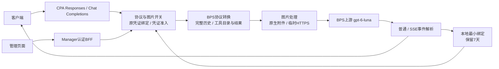

# BPS工具往返与图片输入方案

日期：2026-11-11。项目：MX-CPAMP。本轮目标模型为 `gpt-6-luna`；用户确认接入完整工具调用往返、图片理解（含工具截图和历史图片）、BPS协议开关及图片开关。

本轮增量基线为 `ea8f3eb74ecda571546606b096ba46f4209df340`。此前批量2FA、OAuth交互和凭证并发的已审实现继续保留；各组件最新镜像与真实revision见下方构建记录。二期未推送或部署。

当前整合产品为 `2f51beb7c8f9ed7ecb3c91562fe94824192c6990`，实现、定向独审、最终构建、Web四项及Linux七包race通过，见[最终构建](evidence/bps-tools-images-final/BUILD.zh-CN.md)。[真实验收](evidence/bps-tools-images-final/BUSINESS.zh-CN.md)取得gpt-6-luna文本与原生图片成功，工具首轮HTTP502，未发续轮，整体未通过；不据此准备生产写入。

## 实际边界

已有BPS批次登录、保存注册和正常刷新通过；`gpt-5.6-sol` 修正后的文本请求收到上游HTTP403，错误分类为 `insufficient_quota / permission_error`，见[独立真实回执](evidence/phase2-business-20261111/CORRECTED-RECEIPT.zh-CN.md)。这不能证明其他模型没有权限，也不能证明工具或图片可用。

当前CPA通用翻译器已具备工具和图片的基础结构，BPS专属实现仍只接文本：能力检查拒绝工具及非文本输入，请求准备删除工具参数，事件读取与流式生命周期只接受文本。只移除检查不会形成完整能力。

## 供体

固定本地清洁源码：`C:/Users/子羽/.codex/worktrees/ranxi-v2201-observability/ranxi-v2195-integration-20261105`，提交 `0ef3ce8fe2db1193eeb4cd93f9db9301b4252982`。仅复用其BPS协议和图片处理实现；供体的独立测试不替代CPA适配后的验收，也不表示该提交已部署。

## 设计决策

| 事项 | 状态 |
|---|---|
| 模型 | 已确认：gpt-6-luna |
| 功能范围 | 已确认：工具往返、图片输入、协议与图片开关 |
| 工具执行与续轮方式 | 已确认：客户端执行、完整历史回传；Responses与Chat Completions的普通/流式请求，原BPS凭证绑定 |
| 绑定保留 | 已确认：本地保存最小绑定7天，支持重启续轮；绑定不存聊天正文或图片 |
| 图片传输 | 已确认：同时保留原生上传与临时HTTPS中转，默认原生 |
| 图片支持关闭后的行为 | 已确认：所有图片形态明确报错，保持原始历史 |
| 真实验收 | 已确认：登录和正常刷新各1次；gpt-6-luna文本1次成功后，工具往返最多2次、图片输入1次；文本403则停止后续实测 |

工具由客户端执行。首版使用完整历史，不新增仅凭 `previous_response_id` 恢复会话的能力；BPS WebSocket保持现有限制。凭证失效、被替换或绑定到期时明确失败，正常令牌轮换不改变同身份绑定，不静默换账号或切Codex。

## 请求架构

客户端执行工具期间不占推理并发；结果回传的新一轮重新申请原凭证额度。工具参数仍在输出时继续持有原请求额度，直至真实源结束或取消。沿用默认20、单凭证跨模型共享和最多30秒等待。

## 供体接入边界

供体核心在 `backend/internal/service/basispoints/`：`request.go`、`tools.go`、`stream.go` 及其catalog/schema/history/envelope/replay依赖负责工具协议；`attachments.go`、`tool_images.go`、`image_relay.go` 负责图片。CPA需要适配自己的transport、凭证调度、配置和流生命周期，保留来源说明。

供体的原生模式会将普通消息图片上传为附件；已校验的内联工具截图保持原工具结果形态。HTTPS/file_id工具图片转换为相邻消息时，必须保留调用关联、文字和图片顺序。两种形态按供体语义移植，不能把所有截图统一当作附件。

供体独立BPS平台的Redis账号绑定属于另一宿主入口。本项目采纳其原账号/上游身份校验契约，改用CPA本地最小持久记录，不引入Redis，也不保存工具历史正文。历史状态缺失或原凭证不可用时返回明确冲突。

图片开关采用本轮确认的统一拒绝语义；供体允许部分HTTPS/file_id继续进入的行为不沿用，不增加“忽略图片”选项。

## 图片与状态生命周期

原生模式不要求本站公开图片域名。临时HTTPS模式使用CPA受控的GET/HEAD读取入口，没有公开上传接口；选择中转模式时必须配置有效的本站HTTPS基址。图片保存在CPA私有数据目录，按有效期清理，并确保公开读取路由落到持图实例。

首版采用供体现有默认限制：图片有效期30分钟；每图20MiB；每请求最多20张、合计32MiB；最多64MP；临时存储最多1GiB、512项。绑定记录与临时图片分开存储，图片不因7天绑定而延长保存。

BPS协议和图片默认开启，图片默认原生模式。关闭开关影响后续新请求，不主动中断已经开始的生成；图片关闭时拒绝含当前、历史或工具结果图片的新请求。保存配置后即时生效。

## 适配责任

| 模块 | 适配内容 |
|---|---|
| CPA请求与协议 | 工具定义和选择、函数结果、工具与文本输出、普通和流式生命周期；复用现有通用翻译器 |
| CPA图片处理 | 图片规范化、BPS原生附件与临时中转、工具截图及历史图片的语义和顺序 |
| CPA调度 | 同身份工具续轮绑定、能力判断及开关；保持BPS独立通道和现有凭证并发 |
| Manager与页面 | 读取和保存CPA的协议/图片设置；不接收或持久化模型图片 |
| 登录Worker | 沿用现有BPS登录及令牌导入，不处理工具执行或模型图片 |

## 验收

复用未变的批量登录与并发证据，仅补协议、续轮及图片的新路径。普通与流式请求分别覆盖工具参数分片、工具终态、结果回传同凭证、图片语义、开关切换和取消释放。脱敏记录客户端请求次数及实际HTTP结果，不把模型登记或离线替身通过称为真实业务成功。

真实测试改用 `gpt-6-luna`。本轮按已审工具执行：文本成功后工具首轮失败，跳过续轮，独立图片成功，实际三次客户端模型请求，临时容器与令牌均清理。旧 `gpt-5.6-sol` 回执保留；不重复已失败请求。工具502正在做有界离线定位，上线继续遵守完整验收后统一发布。

没有SQL/schema迁移。运行时新增CPA最小绑定记录、临时图片和协议设置写入；后续发布材料需明确数据挂载与HTTPS读取路由，不直接改变当前生产入口。

## 实施分工

| 执行线 | 工作树与分支 | 单写范围 |
|---|---|---|
| 协议与绑定 | `D:/MX-CPAMP-worktrees/bps-protocol-tools`，`codex/bps-protocol-tools` | 供体核心包、BPS请求/事件/流式、能力判断、调用方与原凭证绑定、必要Go依赖 |
| 图片与设置 | `D:/MX-CPAMP-worktrees/bps-images-settings`，`codex/bps-images-settings` | CPA图片宿主与临时入口、全局配置与管理API、Manager认证BFF及设置界面 |
| 验收工具 | `D:/MX-CPAMP-worktrees/phase2-feature-probe`，`codex/phase2-feature-probe` | 隔离验证工具、gpt-6-luna的文本/工具往返/图片预算与脱敏回执 |

供体核心包由协议线统一接入，图片线通过窄接口复用；配置与HTTP入口由图片线单写。总体方案、真实回执与最终整合由主会话负责，独立审查在提交后进行。未变的组件与证据按实际输入复用。
