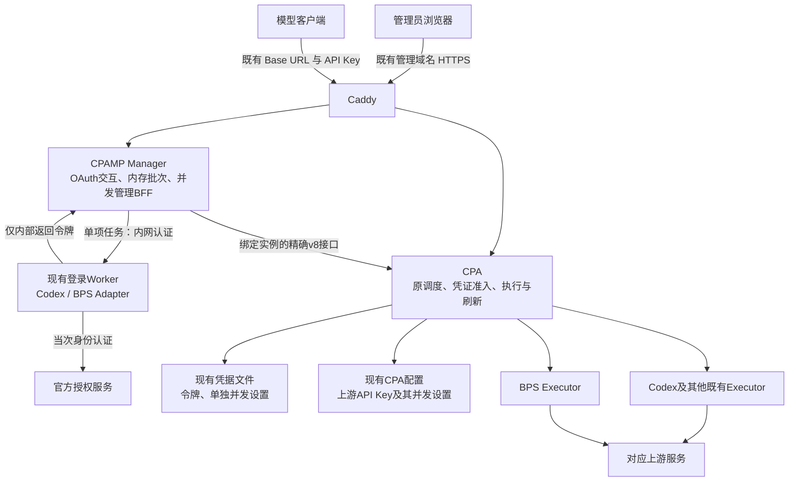
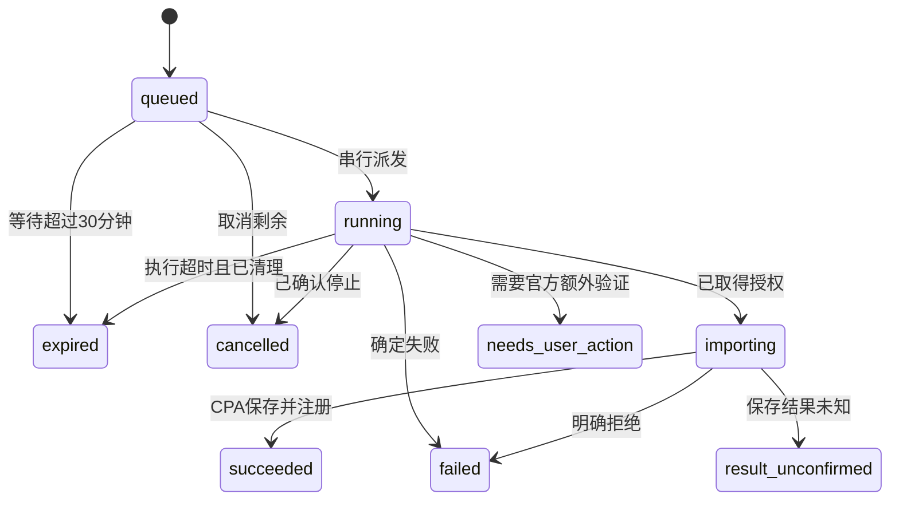

# BPS OAuth、批量 2FA 与凭证并发方案

日期：2026-11-10；实施确认：2026-11-11。项目：MX-CPAMP。产品源码基线：`66736ed731535f94dfce76a1c88a752a98bcc86a`，分支 `codex/openai-bps-login`。用户已确认按[执行安排](execution/phase2-next-20261111.zh-CN.md)开展本地两线实施，完整验收后统一发布；生产保持原状。

现有生产版本为 `mx-cpamp-20261110-rc1`，部署与内部认证检查已通过；页面、真实授权兑换、令牌刷新和模型业务的验收状态分别记录，依据为[生产回执](evidence/deployment/server-release.zh-CN.md)。本方案接续现有架构，术语见[领域词汇](../GLOSSARY.md)。

## 1. 已确认的产品行为

| 项目 | 确定行为 |
|---|---|
| 四个入口 | 保留 Codex OAuth、Codex 2FA、BPS OAuth、BPS 2FA；每次仅取得所选通道授权 |
| BPS OAuth | 明确区分生成链接、打开官方页面、提交回调、保存注册成功；显示可复制的授权链接 |
| 批量格式 | 一行 `邮箱----密码----TOTP种子`，每批最多100条，一批只选 Codex 或 BPS |
| 登录执行 | 串行执行；普通行失败继续其他行；可取消剩余项；补登录不跨通道覆盖凭证 |
| 刷新/关闭面板 | 服务器继续执行，重新打开后可查看脱敏进度 |
| 登录材料 | 未开始条目从批次接收起最多在内存等待30分钟；到期清除；重启不续跑 |
| 令牌维护 | CPA 自动刷新令牌；刷新失效后用户重新提交材料补登录 |
| 凭证范围 | 所有上游凭证，包括其他平台 OAuth 和配置中的每份上游 API Key |
| 并发默认值 | 统一20；现有未设上限的也采用20；已有单独设置保留 |
| 独立额度 | 每份凭证跨模型共享；同邮箱的 Codex/BPS 分别计数；刷新、同身份补登录保留设置 |
| 修改上限 | 可逐份设正整数或恢复默认20；降低上限不终止在途请求 |
| 满额行为 | 优先使用兼容空闲凭证；全满最多等待30秒，超时429 |
| 等待归属 | 未绑定请求等待整个兼容池；已绑定会话只等原凭证；公共等待数单独展示 |
| 现有入口 | 沿用域名、Base URL、客户端 API Key、Caddy、数据挂载和其他平台功能 |

这里的20是本站单个 CPA 实例允许同时使用一份凭证的请求数，不代表上游官方保证支持20并发。批量100条也不代表同时登录100个账号。

BPS沿用当前文本通道的字段限制：`max_output_tokens`、`max_tokens`、`max_completion_tokens` 非null时不受支持，纯BPS候选返回明确400；不静默删除或忽略客户端上限。业务验收使用省略这些字段的最小文本请求；兼容Codex候选按原能力参与调度。

## 2. 现状与问题判断

### 2.1 BPS OAuth：存在入口交互缺陷，真实兑换待验收

当前“打开授权入口”按钮只向后台创建会话，创建成功后自身禁用；真正的入口是下方“前往官方授权页面”链接。全局 reset 样式让链接继承正文色并移除下划线，造成“没有授权链接”的观感。

当前 Start 数据链字段一致：浏览器 `POST /api/oauth-login/oauth/auth-url`，Manager 调用 CPA `POST /v8/management/oauth/auth-url`，CPA 返回 `url/state`，Manager 原样交给页面。现有证据支持修正交互，不足以判定官方回调兑换已经可用。

源码定位：

- `components/cpamp/apps/web/src/features/oauth/InternalLoginCards.tsx:219`：创建会话；`:265`：按钮与链接。
- `components/cpamp/apps/web/src/styles/reset.scss:41`：链接默认样式。
- `components/cpamp/apps/web/src/features/oauth/OAuthPage.tsx`：已有授权链接展示、复制交互可复用。
- `components/cpamp/apps/manager-server/internal/service/oauthlogin/service.go`：实例绑定、回调提交与状态查询。

### 2.2 批量 2FA：复用单项执行，增加内存编排

Manager 与 Worker 现有单任务限制适合本次串行需求。新增 Manager 批次队列，复用单项登录、取消、CPA 原子导入与结果清理；Worker 继续一次执行一项，不增加 Redis、数据库队列表或并行登录进程池。

当前 Manager 请求体上限32KiB，不足以作为100行批次契约；已有单项查询按创建时间30分钟过期，也不适合作为批次结果的唯一来源。批次需要独立的脱敏摘要、输入限制和生命周期。

源码定位：`components/cpamp/apps/manager-server/internal/http/controller/oauthlogin/handler.go:76`、`internal/service/oauthlogin/service.go:111`、`:117`、`:175`、`:312`、`:367`；Worker 为 `components/oauth-login/src/tasks.mjs`。

### 2.3 凭证并发：新增 local 准入，保留原调度

当前 local 模式没有覆盖所有执行路径的每凭证硬上限与等待队列。现有 Home 权威并发协议只作用于 Home 生命周期；weighted selector 的 `inFlight` 是选择权重保留量，不能当成本地真实在途请求数。

新增轻量准入状态放在 CPA 的凭证执行管理器，复用原账号候选、能力过滤、pin/affinity 和重试。CPAMP 只负责设置与展示，Worker 不参与模型请求。

源码定位：`components/cpa/sdk/cliproxy/auth/conductor_execution.go`、`selector_weighted.go:136`、`conductor_home.go`、`components/cpa/internal/config/credential_concurrency.go`、`components/cpa/sdk/cliproxy/executionregistry/`。

## 3. 架构与写入责任



| 模块 | 本期增加 | 状态归属 |
|---|---|---|
| Web | 醒目 OAuth 链接、批量输入和进度、凭证并发设置与计数 | 仅交互状态；不存密码/TOTP |
| Manager | 批次编排、活动批次查询、最窄并发 BFF | 未派发秘密与脱敏进度仅内存；不持久保存登录材料 |
| Worker | 原单项协议优先复用，核实结果清理确认 | 当次任务；25分钟执行超时；完成后清理 |
| CPA 准入 | 原子占用/释放、全池或定向等待、运行快照 | 单 CPA 进程内，不跨副本计数 |
| CPA 持久化 | OAuth metadata 的上限；配置 Key 条目的上限 | 沿用现有文件、配置与写入协调 |

不增加新的账号池或模型网关。Home 模式继续使用 Home 权威机制，本期验收对象为现有单实例 local 部署。

## 4. BPS OAuth 交互与真实验收

页面顺序为“生成授权链接”→“前往官方授权页面”→“粘贴完整回调 URL”→“提交回调”→“等待保存注册”。生成后同时显示可复制 URL 与醒目打开按钮；使用现有 OAuthPage 的链接展示能力，避免异步请求后强行弹窗被浏览器拦截。

- 打开行为使用返回的真实 URL，新页保留 `noopener noreferrer`；链接有明确颜色、焦点态和文案。
- 保留固定 BPS profile、PKCE/state、官方回调和 CPA 实例绑定；取消遵守现有会话锁语义。
- 显示“创建链接失败”“回调已接收”“等待保存”“保存结果待确认”等实际阶段；错误附稳定白名单错误码，不显示原始异常、token 或回调内容。
- 只有 CPA 终态确认 `saved/registered` 后才显示导入成功并刷新凭证列表；回调 ACK 只表示收到。
- 将开发验收说明留在文档中，产品页面提供状态和下一操作。

优先完成一条 BPS OAuth 纵切：生成 URL、实际打开、官方授权、回调接收、兑换、CPA 保存注册。官方回调是否提前消费 code 以真实脱敏回执判断；明确拒绝与结果未知分别处理，后者不自动重复兑换。若官方流程不支持当前回调交接，先确认受支持的授权路径并修正方案，保留清楚的未通过结论。

## 5. 批量 2FA 设计

### 5.1 输入与页面

Codex 2FA 与 BPS 2FA 使用同一批量组件、不同固定 profile。单条登录就是一行输入，不再要求逐账号打开表单。

1. 输入一批最多100条非空行，保留原行号；按首个和末个 `----` 分隔邮箱、密码、TOTP，密码内容保持原样。
2. 预览只展示行号、遮罩邮箱、校验与重复提示。邮箱按现有身份规则规范化，TOTP 按 Worker 的 Base32 与长度契约校验；密码不 trim。
3. 同批同通道重复邮箱标记并跳过。普通坏行记逐行错误，其他有效行继续；超过100条、非法 profile、超出总大小等结构错误整批拒绝。
4. 提交成功后清空文本与解析数组中的秘密。提交回执未知时按预先生成的 `batch_id` 查询，不盲目重交整批。
5. 进度显示总数、成功、失败、待人工验证、过期、取消和当前行；“取消剩余”明确不删除已导入凭证。

服务端再次校验。建议批次正文上限1MiB、每条遵守 Worker 原16KiB限制，避免只增加行数而被现有32KiB入口拒绝。

### 5.2 拟新增 Manager 契约

接口是本期拟实现契约，不代表当前生产已存在：

```text
POST   /api/oauth-login/batches
       {batch_id: UUID, profile: codex|bps,
        items: [{line_no, email, password, totp_secret}, ...]}
GET    /api/oauth-login/batches/active
GET    /api/oauth-login/batches/:id
DELETE /api/oauth-login/batches/:id
```

沿用管理员鉴权与连接范围。同一 Manager 一次只有一个活动登录批次；批次占用登录执行通道，其他批次/单项创建返回忙，不能插入两行之间。同一进程的摘要保留期内，相同 `batch_id` 返回已有回执，不因再次 POST 重新执行；重启或查询404不证明此前没有导入，页面先核对已保存凭证，不自动重交。查询返回 `profile`、脱敏行状态、时间、稳定错误码、成功 `auth_id`，不返回密码、TOTP 或 token。

批次接收时固定 CPA setup。每行启动前、导入前均复核同一实例与连接来源；中途切换 CPA 连接则中断批次，不把后续行导入另一个实例。批次摘要独立于原单项 Get 的30分钟寿命；终态后在内存保留1小时，重启后只剩 CPA 已保存的凭证。

### 5.3 状态与故障边界



普通行失败、需要人工验证可继续下一行；以下情况中断整批，清除未启动材料，并等待核实：保存结果未知 `import_unconfirmed`、Worker 停止/结果清理未确认、CPA 实例变更、基础服务不可用。批次中断与某行失败区分展示，不自动重放未知结果。

取消时立即清除未开始材料。当前行在登录中，确认进程组已退出后再标取消；当前行已进入 importing，则等待实际保存结果。每行仅在提交导入期间获取现有 mutation 协调，不把整个批次锁成一次全凭证写操作；Worker 槽位和授权结果清理确认后才开始下一行。

### 5.4 时间与秘密生命周期

- **等待30分钟**：从批次接收时开始，对未派发条目统一计时；刷新面板不延长。
- **执行25分钟**：当前条目复用现有登录执行时限，与等待TTL分开；已开始条目可执行至自身超时。
- **取消/失败/到期/中断**：移除尚未开始的秘密引用；传入 Worker 的材料继续使用 stdin/私有 pipe，不经 argv/env/文件、数据库、日志或浏览器存储。
- **重启**：不从磁盘恢复材料；沿用 Worker 遗留任务清理，再接受新批次。正在保存的最后一项先查实际凭证状态。
- **重试**：失败和过期条目重新提交登录材料；不提供依赖暗存密码的一键重登。

100条串行登录可能耗时超过30分钟，因此不承诺全部执行；到期尚未开始的条目明确显示“材料已过期”。内存清理指移除业务可访问引用，不承诺语言运行时或宿主机内存的物理擦除。

## 6. 所有上游凭证的本地并发

### 6.1 持久设置与运行计数

| 凭证来源 | 持久字段 | 编辑路径 |
|---|---|---|
| OAuth/凭据文件 | `Auth.Metadata["concurrency_limit"]` | CPA v8 `/credentials/fields`，复用 mutation/persist |
| 配置上游 API Key | 每个配置条目的 `concurrency-limit` | CPA v8 `/config/*path`，保留 ETag/If-Match |
| 所有来源缺省 | 本期统一默认20 | 运行时回落；无须批量重写所有旧凭证 |

配置类型覆盖 Claude、Codex（含共用结构的平台）、Gemini/Interactions、OpenAI compatibility 每个 `keys[]` 条目、Vertex compatibility。v8 配置展开与还原、synthesizer、watcher、配置条目到 Auth 映射都保留上限；数值不参与 AuthID 生成。

同 provider＋同官方 identity 的刷新/补登录，继续保留原 metadata 上限；三方 merge 避免旧刷新覆盖期间的新设置。配置凭证的限制随配置条目保存，不伪造 authfile。替换 API Key 或影响身份的连接设置可能生成新 AuthID，属于新运行身份；旧请求仍对旧 lease 收尾，不把配置数组下标当成永久凭证 ID。

运行状态由独立内存表维护，按 AuthID 与活跃代际引用计数，不放进 token 刷新会替换的对象。提供 `active`、`effective_limit`、`limit_source`、`pinned_waiting`；CPA 实例另给 `pool_waiting`。例如卡片显示“运行3/20、定向等待1”，页面顶部显示“公共等待4”。

### 6.2 准入与等待

1. 原调度先做模型能力、可用性、会话绑定过滤，再原子 `TryAcquire`；成功后才开始执行。
2. 当前候选满额则继续查本次其他兼容候选；本地满额不记上游错误、不触发冷却、不消耗上游请求重试次数，也不以该次数上限代替整个兼容池的容量判断。
3. 仅容量不足时进入等待。未绑定请求记录公共等待，任一兼容容量释放后重新走原调度；有 pin 的仅等待原凭证。
4. `Release`、提高上限、凭证变化触发容量通知；等待不占全局调度锁或 WS 状态锁。一个通知不代表占额成功，仍以原子获取为准。
5. 每请求累计准入等待最多30秒，不因重新选候选、唤醒或重试重置；WS按每个生成 operation 独立计算预算。超时返回429语义及稳定代码 `credential_concurrency_timeout`，按当前传输协议交付。
6. 工程上设置每实例最多1000个等待请求，满时立即429 `credential_queue_full`；主动取消立即离队。无可用授权、模型不兼容等错误保持原语义，不伪装成容量不足。

不承诺严格 FIFO；现有 scheduler 决定兼容账号选择。降低上限时已有执行继续，暂时出现 `active > effective_limit` 合理；停止新准入直至低于上限。禁用/删除凭证唤醒并重新判定等待，旧 lease 直到执行结束才释放，禁止旧释放操作改动新身份计数。

### 6.3 执行生命周期

并发上限覆盖原先使用凭证的非流式、SSE、CountTokens、fallback 与 WS 执行路径：

- 非流式：执行开始占用，执行退出释放；同凭证401刷新重试复用占用，换凭证先释放再获取。
- SSE：真正源流结束、异常退出或取消清理后释放；`ExecuteStream` 返回流对象时仍在占用。空流、bootstrap失败、准备拒绝、换账号重试均只释放一次。
- CountTokens 与 Antigravity credits fallback：接入同一准入，避免直接 executor 路径漏限。
- WebSocket：按活动生成 turn 计数，空闲连接不占用；首 turn 复用 Manager 已获取的 lease，经执行选项交给执行器，后续 create/自动 successor 发送前通过同一准入器获取。每个 operation 的终态/取消/断线只释放一次，steering 不新增占用，socket 生命周期引用与生成额度分开。
- WS 等待不得阻塞取消控制帧或连接关闭；取消先使执行真正退出，再释放额度，避免下游已断开而上游仍运行时提前空出容量。
- HTTP/SSE 在尚未提交响应头时返回 HTTP429；已升级的 WS 连接使用与该 operation 关联的协议错误事件，携带 `status=429` 和稳定错误码，不尝试改写握手的 HTTP 状态。

关键实现点为 `codex_websockets_session.go` 与 `codex_websockets_duplex.go` 的后续 operation；不能只在首次 Manager dispatch 加 semaphore 就宣称覆盖 WS。

### 6.4 并发管理接口与页面

拟新增 CPA 只读 `GET /v8/management/credentials/concurrency` 提供本实例快照。CPAMP 提供窄接口 `GET/PATCH /api/credential-concurrency`，只接受凭证引用和并发设置，通过现有映射分别调用凭据字段或配置条目写接口；不接受浏览器传任意 CPA 路径。

设置界面支持“默认20/单独设置N”，验证正整数，恢复默认时移除覆盖值。列表对所有上游凭证提供统一入口，配置 Key 用脱敏描述和真实条目映射定位；写入前复核实例与配置版本，冲突提示刷新，不编辑已换位的条目。快照响应不包含原始上游 Key 或 token。

CPAMP 现有 authFiles 字段编辑仍有 v0 路径；本期单独做精确 v8 BFF，不顺带迁移整套 v0 管理代理，也不放开整个 v8 子树。

## 7. 两条实施线与先后顺序

任务已进入本地实施，从固定产品基线及本轮规划文档建立隔离工作树；未知改动原位保留，文件域按下表划分。

| 任务要素 | A：CPA 准入与管理契约 | B：Manager/Web 登录与并发管理 |
|---|---|---|
| WHY | 每份凭证上限需要覆盖真实执行路径 | 修复授权入口并支持批量导入与逐凭证设置 |
| WHAT | local 准入、等待、运行快照、OAuth metadata、配置 Key 字段与生命周期 | OAuth链接交互、批次内存编排、进度恢复、窄BFF、所有凭证设置UI |
| WHERE | `components/cpa/**`；`docs/contracts/credential-concurrency.md`；本线证据 | `components/cpamp/**`；必要的 Worker 清理确认；批次契约与本线证据 |
| HOW MUCH | 先HTTP/SSE纵切，再WS/Count/fallback；只改相关执行路径 | 复用单任务与页面组件；Worker输入与授权协议优先不变 |
| DONE | 上限20真实竞争不超卖；全池/定向等待、生命周期、热更新与持久化专项通过 | 批次/取消/未知结果/实例切换专项及UI通过；BPS实际授权按真实回执单独验收 |
| DON'T | 不建第二调度器，不改变Home权威或既有模型能力过滤 | 不长期保存密码，不改客户端Key规则，不大改通用代理 |

P9 单写总体方案与实施入口；A 单写 CPA 公共执行与配置文件，B 单写 Manager/Web；接口契约先冻结再联调。跨线变更先同步接口，不交叉编辑同一文件。

推进顺序：

1. 修复 BPS 链接展示，并把真实 OAuth 纵切列为首个业务验收点。
2. A/B 冻结并发快照、字段和错误语义；A 实施准入，B 可并行完成批量登录。
3. B 接入所有上游凭证并发设置；A 补齐 WS/Count/fallback 与配置合成。
4. 独立审阅后做一次整合构建与隔离检查，准备固定版本发布材料。
5. 生产切换与真实账号/模型验收按后续明确指令执行，分别记录结果。

## 8. 最小充分验证与数据影响

实施阶段的最小充分验证围绕以下真实失败；当前不访问生产服务器：

| 验证对象 | 要检测的失败 |
|---|---|
| BPS OAuth UI/API | 实际 href 错、复制值错、会话创建即误报成功、错误阶段被混淆 |
| 真实 BPS OAuth | 官方回调/兑换不成立；假上游、HTTP200或链接可点均不能替代 |
| 批次 | 100条限制、密码被 trim、重复执行、30分钟秘密未清、刷新页面取消后台任务 |
| 取消/未知结果 | Worker未退出即开始下一行、导入未知自动重放、已保存账号被当作取消 |
| 连接切换 | 后续条目/并发写入落到错误CPA实例或配置条目 |
| 并发竞争 | 20个已占额时第21个仍被发送；不同模型漏共享、不同凭证错误共用 |
| 等待 | 释放后不唤醒、pin被换号、公共等待重复计数、超时被重置、取消不离队 |
| 执行生命周期 | SSE/WS过早释放或泄漏；WS后续turn、Count/fallback绕过 |
| 持久设置 | 刷新/补登录覆盖上限、配置转换丢字段、修改上限重建AuthID、旧lease误减新计数 |

受影响包专项通过后，仅做一次整合构建和隔离健康/假上游集成；源码、依赖和构建输入未变的 Worker 证据可复用，记录等价依据。真实 OAuth、所属 client 刷新和真实模型业务保留各自回执，不用构建或健康检查代替。

**数据库动作：无新增 SQL/schema 迁移。运行时数据影响：**实施后修改上限会更新既有凭证 metadata 或 CPA 配置条目；真实导入会新增/更新凭据；旧的缺省凭证上线后立即采用20，可能新增排队/429。Manager SQLite 不新增密码/TOTP、批次秘密或队列表，现有备份和密钥保留。

当前结论：需求决策已收齐，独立只读设计审阅通过，用户已确认本地两线实施。此前两通道单条真实2FA测试均返回 `needs_user_action`，未取得保存注册成功回执，见[本地真实测试记录](evidence/real-2fa-20261110/RECEIPT.zh-CN.md)；下一次真实测试前先补足阶段诊断。该记录不验证生产出口、手工OAuth、刷新或模型业务；产品验收按上表与执行安排分别核证。
